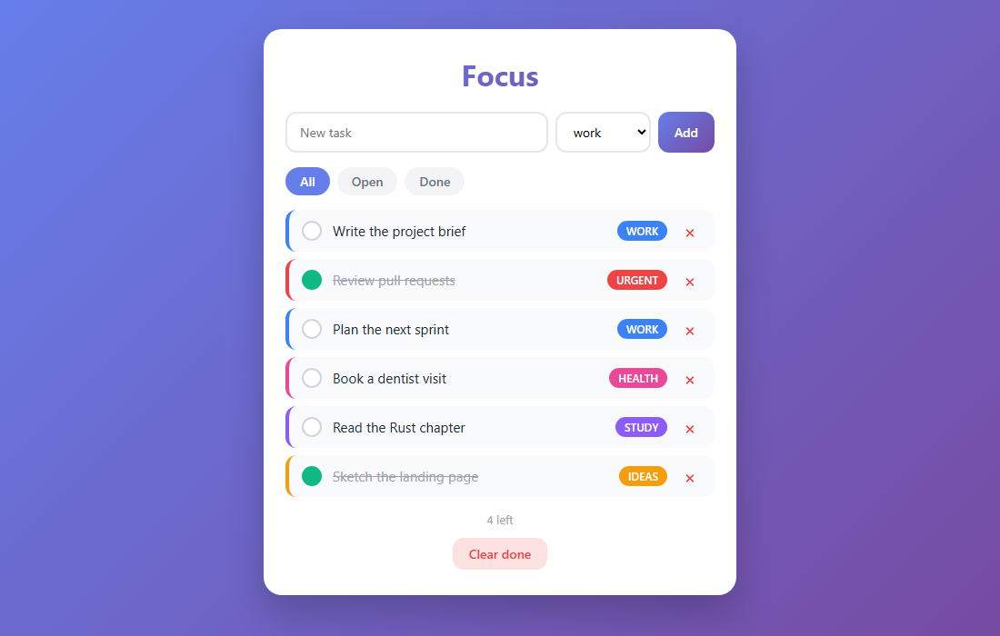
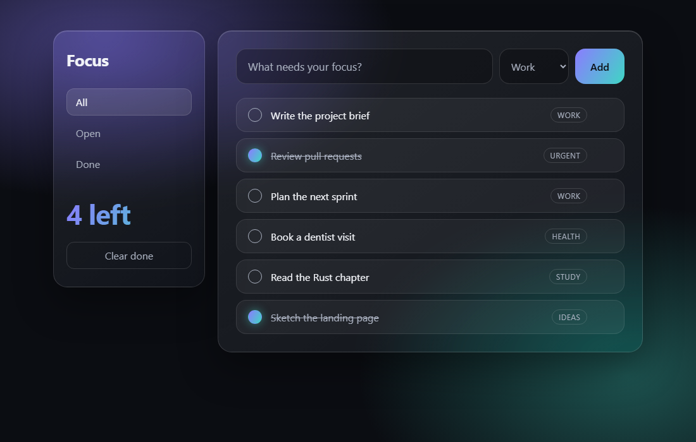

# reskin

Agent skills that redesign an existing app without changing what it does.

Give it screenshots you like, or the name of a style. It works out what the app is, writes a `DESIGN.md`, rebuilds the look and the layout, compares the result with your reference and checks that everything still works.

```
/reskin                        applies the project's DESIGN.md, or offers styles if there is none
/reskin linear                 redesigns in the Linear style
/reskin + screenshots          takes the look from your screenshots
/reskin stripe + screenshots   uses Stripe as a base, and the screenshots override it
/reskin add an export button   does the task under the project's DESIGN.md

/reskin-style + screenshots    applies the whole look, without moving anything
/reskin-full + screenshots     builds 3 versions you can open, from a light layout change to a complete one
/reskin-full 5 linear          builds 5 versions, in smaller steps
```

## Example

A to-do app with tags, filters and delete, before and after. Same script and behaviour. Before is the default AI look: purple gradient, white card, a rainbow of tags. After is the skill's output: a rail and a stage in glass, with one accent instead of six tag colours.

| Before (default AI look) | After (`/reskin`) |
|---|---|
|  |  |

Files in [`examples/task-board`](examples/task-board), with the resulting [`DESIGN.md`](examples/task-board/DESIGN.md). Written by hand to show the target, not the recorded output of a run.

## How it works

```
screenshots ─┐
             ├─> understand the app ─> DESIGN.md ─> redesign ─> compare with the reference ─┐
style name ──┘                                          ^                                   │
                                                        └───────── fix what falls short ────┘
```

- **It understands the app first.** Each screen's main action, what every element is for, and what code depends on.
- **It finds the signature.** The few traits that make the reference recognisable, which then have to show on every screen.
- **It works out how things are built.** A screenshot of glass shows glass plus what is behind it. Copying that colour gives a flat panel, so it rebuilds the layers.
- **Colours are measured.** A small script with no dependencies reads your screenshots' pixels. PNG is read directly. JPEG, WebP and others are converted with what your system already has: Windows Imaging Component, `sips` on macOS, or ImageMagick or ffmpeg on Linux.
- **It compares and corrects.** It puts the result next to the reference and fixes the largest gap, for up to three rounds.
- **The app stays itself.** Features, flows, wording and themes stay. So do its name, a font chosen on purpose, and the hue of colours that carry meaning, which still wear the new material.
- **Nothing is left behind.** It goes through the stylesheet rule by rule and looks at every element, including those your scripts generate.
- **The look survives.** `DESIGN.md` records all of this, and your own choices carry over each time it is regenerated.

## Install

Pick one. The skills do the same either way, only the command names differ.

**As a plugin.** In Claude Code:

```
/plugin marketplace add RuBNouS/reskin-skill
/plugin install reskin@reskin-skill
```

The commands are then `/reskin:reskin`, `/reskin:reskin-style` and `/reskin:reskin-full`.

**As plain skills, for `/reskin`.** Needs Node.js and a copy of this repository:

```bash
git clone https://github.com/RuBNouS/reskin-skill
cd reskin-skill
node install.mjs --global
```

`--global` installs for every project. Without it, the skills go into `.claude/skills` of the folder you run it in. `--to <folder>` installs anywhere, which suits other agents that read skills. The three folders must stay together, because the other two read `reskin`; the script copies them together and the skills tell you if one is missing.

## Requirements

- **A git repository with no uncommitted changes** in the files that will change, so the redesign can be undone. If not, the skill stops and tells you to commit or stash first.
- **A browser the agent can drive.** Without one, the comparison with your reference and the click-through, which is where most of the quality comes from, cannot run, and the skill asks you for captures instead. In Claude Code, enable the Claude in Chrome extension. In the Claude desktop app, its built-in browser works. The skill checks for one at the start and tells you if it is missing.
- **Node.js**, to measure colours. Without it, or with an image your system cannot convert, colours are estimated and marked as such.
- **Network access**, only for named styles, which are downloaded when you ask for one. If the download fails, the skill says so and asks for screenshots or a description instead.

`/reskin-full` makes one complete redesign per direction, so 3 directions cost about three times a single `/reskin`. It says so before it starts, and asks first above 4. It also installs the app's dependencies in each worktree so every direction can run.

The skill asks before adding a line about `DESIGN.md` to your `CLAUDE.md` or `AGENTS.md`. It does not edit them on its own.

## Limits

- It redesigns existing web interfaces. Native mobile, desktop toolkits and terminal apps are not supported, and to build an app from nothing other tools fit better.
- Styling is done the way the project already does it: stylesheets, Tailwind config and classes, or a CSS-in-JS or component library theme. It does not add a styling system.
- Changing the layout carries more risk than changing colours. Your tests and the click-through catch most of it, and git brings back the rest.
- Screenshots hold no real values for fonts and sizes, so those are approximations.
- Most named styles analyse a product's marketing site, not its app, so some rules have to be adapted or dropped.
- Anything drawn by code, such as canvas, WebGL or a game world, is left alone. In a game, only the menus and overlays change.
- Styled dropdown lists need a browser with `appearance: base-select`. Others show their default list, which still works.
- How much of your app it can check depends on your tests and on whether your agent has a browser.
- A style is a starting point for your own product. It gives you no rights to a brand's name, logo or identity, so do not use it to pass as that brand.

## Credits

Named styles come from [VoltAgent/awesome-design-md](https://github.com/VoltAgent/awesome-design-md) (MIT, Copyright (c) 2026 VoltAgent). They are downloaded at a pinned commit, are not included in this repository, and keep that credit in the `DESIGN.md` they produce.

The `DESIGN.md` format comes from [Google Stitch](https://github.com/google-labs-code/design.md).

This project is not affiliated with those projects or with any of the brands whose styles it can use. Brand names only identify a style and belong to their owners.

## License

MIT
